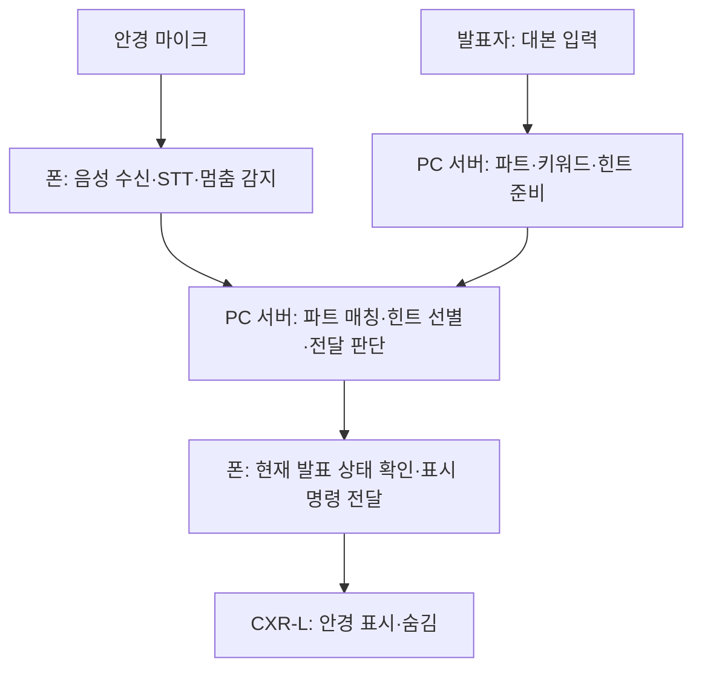

# 발표 힌트 안경 최종 개발 계획

작성일: 2026-11-21

- 목표: 발표 중 말이 멈추면 현재 내용에 맞는 힌트를 안경에 표시하고, 핵심 내용 전달을 판단해 숨긴다.
- 기술 구성: 기존 Kotlin·Compose·CXR-L 앱, PC의 Python/FastAPI 서버, 키워드 추출용 LLM API.
- 기준: 이 파일의 기존 메모와 대화에서 정리한 계획. 원본 메모는 하단에 보존한다.
- 상태: 코드 대조 및 1차 상태 처리 보완 완료. 아래 체크는 코드 구현 여부이며 빌드·테스트·실기기 통과를 뜻하지 않는다.
- 실행 원칙: 2026-11-21 사용자의 구현 요청으로 본 문서의 1차 범위 개발을 시작한다. 테스트 실행·통과 판정은 사용자가 한다. 문서 밖 기능 및 후순위 기능은 추가하지 않는다.

## 2026-11-22 타임아웃·설정값 검증

승인 범위: 서버 모델별·원격 전체·분석 전체 기한과 설정값 검증. 새 패키지 추가 없이 기존 구조를 보완한다.

구현 코드:

- backend/app/analyzer.py: HTTPX의 청크별 읽기 제한 외에 모델별·원격 전체 asyncio.timeout을 추가했다. 마지막 모델은 남은 원격 시간을 사용한다. 원격 기한 오류는 재시도 가능한 llm_timeout으로 유지한다.
- backend/app/main.py: 원격·로컬을 포함한 전체 분석 기한을 적용한다. 초과 시 504 analysis_timeout을 반환하고 해당 요청의 결과를 저장하지 않는다. 같은 Task에서 실행해 실제 분석 출처와 LLM 대기 시간을 보존한다.
- backend/app/config.py: ANALYSIS_TIMEOUT_SECONDS 기본 55초를 추가했다. 활성 원격 45초와 로컬 10초의 합이 전체 기한을 넘거나 전체 기한이 폰 읽기 대기 60초 이상이면 시작 시 거부한다.
- 시간은 양의 유한 수, MAX_SCRIPT_CHARS·MAX_PARTS는 양의 정수로 검증한다. 불리언 오타와 잘못된 URL·포트도 거부하며 오류에 입력값을 노출하지 않는다.
- mock·keybert 모드는 관계없는 원격 설정 오류에 영향받지 않게 한다. 키·모델 누락과 로컬 모델 파일 준비 여부는 기존처럼 요청 시 확인한다.
- ScriptAnalysisClient.kt·HintServerClient.kt: 연결·읽기 제한 0·음수 생성을 거부한다. 폰 기본 연결·읽기 시간은 유지한다.
- backend/.env.example·backend/README.md: 시간 관계와 설정·사용자 확인 방법을 기록했다. 실제 .env는 수정하지 않았다.
- 테스트 소스: backend/tests/test_config.py, backend/tests/test_deadlines.py, NetworkTimeoutValidationTest.kt. 가짜 HTTP·분석기로 취소·기한·실제 출처·저장 차단과 설정 경계를 확인하도록 작성했다.

사용자 확인 필요:

1. backend에서 아래 테스트를 실행한다. 느린 가짜 원격 요청이 취소되고 대체 모델을 시도하며, 전체 기한 초과는 504이고 새 준비 결과가 생기지 않아야 한다.
2. 사용 중인 .env에서 활성 분석기 시간 합계가 전체 기한 이하이고 전체 기한이 60초 미만인지 확인한다. 시간에 NaN·0, MAX_PARTS에 0, 불리언에 오타를 넣으면 값 노출 없이 설정 이름을 안내하며 시작이 거부돼야 한다. 확인 후 원래 값으로 복구한다.
3. 정상 Gemini 분석·로컬 대체에서 실제 출처와 시간 기록을 확인한다. API·모델 오류가 기존 오류 코드로 처리되는지 확인한다.
4. Android 단위 테스트와 앱 빌드를 사용자가 실행하고 폰에서 정상 분석·오류 후 재분석을 확인한다.

~~~powershell
# backend 폴더
.\.venv\Scripts\python -m pytest tests/test_config.py tests/test_deadlines.py tests/test_fallback.py tests/test_keybert_fallback.py tests/test_gemini.py tests/test_omniroute.py tests/test_analyze.py -q
# android 폴더
.\gradlew.bat --console=plain testDebugUnitTest --tests "com.rokid.renewcxrlsample.script.*" --tests "com.rokid.renewcxrlsample.presentation.*"
.\gradlew.bat --console=plain assembleDebug
~~~

미검증·한계:

- 빌드·테스트·설치·실제 API·KeyBERT·폰 실행은 수행하지 않았다. 실행 결과와 통과 판정은 사용자 확인 필요다.
- asyncio 기한은 협력적 취소다. 동기 처리·취소 정리로 늦어질 수 있고 KeyBERT 스레드를 강제 종료하지 않는다. 기존 잠금이 실행 중 중복 요청을 막는다.
- 폰 읽기 제한은 무응답 시간 기준이며 요청 전체 경과 시간이나 블로킹 I/O의 즉시 중단을 보장하지 않는다. 네트워크 지연은 서버 분석 시간 외에 추가된다.
- 3초 침묵·5초 표시·키워드 규칙과 진단 정보 위치는 변경하지 않았다. SDK 응답 구분은 이번 범위가 아니다.

## 2026-11-22 버그 3건 수정

승인 범위: 늦은 파일 읽기 결과의 대본 덮어쓰기 방지, 숨김 실패 상태·재시도 보존, 분석 화면 종료 시 상태 정리.
타임아웃·설정값 검증·SDK 응답 구분 개선은 이번 수정 범위가 아니다.

구현 코드:

- 파일 읽기를 시작할 때 대본 수정 번호와 읽기 작업 번호를 기억한다. 그사이 대본이 바뀌거나 새 읽기 작업이 시작되면 오래된 결과·오류를 버린다.
- 직접 대본을 수정하면 진행 중인 읽기 작업을 취소한다. 이전 읽기 작업의 finally가 새 읽기의 로딩 표시를 끄지 않게 한다.
- 파일 결과는 Controller에서도 수정 번호를 비교한 뒤 반영한다. 늦은 파일 결과가 최신 대본·파일 이름·분석 상태를 바꾸지 않는다.
- 분석 ViewModel은 자신이 시작한 AnalysisTicket을 보관한다. 정상 결과·오류·취소·화면 종료 시 해당 요청만 정리한다.
- 이전 요청의 늦은 finally가 새 요청을 취소하지 않도록 취소도 요청 번호를 확인한다. 사용자가 누르는 명시적 분석 취소는 기존처럼 현재 요청을 취소한다.
- 분석 화면 종료 시 공유 준비 상태가 분석 중으로 남지 않게 한다. 회전은 같은 ViewModel을 사용하므로 종료로 취급하지 않는다.
- 키워드 전달·표시 만료·발표 종료 시 숨길 문구와 처리 이유를 pendingHide로 보존한다.
- 숨김 전송 실패 시 대기 상태와 미리보기 문구를 유지하고, 새 힌트 요청을 차단한다.
- 안경 화면이 다시 열렸을 때 현재 발표 중·자동 중단 상태라면 대기 숨김을 한 번 재시도한다. 종료된 발표가 다른 화면을 자동으로 지우지 않게 한다.
- 안경 화면이 열려 있으면 수동 다시 비우기 버튼을 제공한다. 발표 중에는 종료 버튼을 유지하고 미리보기 아래에 재시도를 표시한다.
- 숨김 전송 성공 시에만 대기를 해제하고 원래 처리 결과(전달·만료·종료)를 복원한다. 종료 재시도와 새 발표 시작에서도 이전 대기를 잃지 않는다.
- 시작 시 화면 비우기가 실패한 경우도 숨김 대기로 남겨 새 힌트와 섞이지 않게 한다.

사용자 확인 필요:

1. 파일 불러오기를 시작한 뒤 읽기가 끝나기 전에 대본을 수정한다. 수정한 대본이 유지돼야 한다.
2. 대본을 수정했다 원래 문장으로 되돌린 경우에도 이전 파일 결과가 적용되지 않아야 한다.
3. 분석 중 뒤로 나간 뒤 준비 화면을 다시 연다. 기존 대본은 남고 분석 중 표시가 고정되지 않으며 다시 분석할 수 있어야 한다.
4. 분석 취소·재시작을 연달아 수행한다. 이전 요청 정리가 새 분석 결과·진행 상태를 지우지 않아야 한다.
5. 키워드 전달 또는 5초 만료 시 숨김 전송이 실패하는 상황에서 이전 문구와 대기 안내가 남고 새 힌트가 겹치지 않아야 한다.
6. 다시 비우기를 눌러 전송에 성공하면 대기가 해제돼야 한다. 만료로 숨긴 경우 전달 완료로 바뀌면 안 된다.
7. 발표 중·중단 상태에서 연결·안경 화면을 다시 열어 대기 숨김 재시도를 확인한다.
8. 종료 후 다른 화면으로 이동했을 때 이전 발표가 그 화면을 자동으로 비우지 않는지 확인한다.
9. 종료·시작 화면 비우기 실패 후 재시작에서도 이전 대기가 유지되는지 확인한다.

테스트 소스 추가: ScriptPrepControllerTest 5건, PresentationControllerTest 6건.
Android 폴더에서 사용자 실행:

~~~powershell
.\gradlew.bat --console=plain testDebugUnitTest --tests "com.rokid.renewcxrlsample.script.*" --tests "com.rokid.renewcxrlsample.presentation.*"
~~~

미검증·한계:

- 빌드·테스트·파일 공급자 지연·기기 연결 실패 상황은 AI가 실행하지 않았다.
- 숨김 성공은 기존 SDK 전송 반환값 기준이다. SDK가 늦게 보내는 요청 ID 없는 응답의 구분과 실제 안경 반영은 별도 확인 필요다.
- 취소된 블로킹 파일·HTTP 읽기는 플랫폼 호출이 끝날 때까지 남을 수 있다. 늦은 결과는 적용하지 않으며 네트워크의 실제 중단·전체 기한은 다음 타임아웃 단계에서 검토한다.
- 3초 침묵·5초 표시·최대 키워드 수와 기존 진단 정보 위치는 변경하지 않았다.

## 2026-11-22 숨김 대기 중 시작 버튼 유지

승인 범위: 발표 종료 뒤 숨김 대기가 남아도 하단에서 새 발표를 시작할 수 있게 한다 (위 9번 확인 항목과 맞춤).

구현 코드:

- 발표 화면 하단 바에서 "안경 화면 다시 비우기"가 시작·연결·대본 확인 버튼을 대신하지 않고 그 위에 함께 보인다. 발표 중·준비 중에는 기존처럼 종료 버튼만 보이고, 재시도는 미리보기 아래에 있다.

정책 유지 (변경 없음):

- 시작 시 화면 비우기 실패도 숨김 대기로 남기고, 대기 중에는 새 힌트 요청을 막는다. 발표 중 주기적 자동 재시도는 넣지 않는다 (사용자 결정 2026-11-22).

사용자 확인 필요:

1. 힌트 표시 중 발표를 종료하고 숨김 전송이 실패하게 한다. 하단에 "다시 비우기"와 "발표 시작"이 함께 보여야 한다.
2. 그 상태에서 "발표 시작"을 누르면 시작 절차가 진행되고 이전 숨김 대기가 유지돼야 한다.
3. 숨김 전송이 성공하면 "다시 비우기" 버튼이 사라져야 한다.

미검증: 빌드·실기기 화면은 AI가 실행하지 않았다. 이 화면은 ViewModel·SDK가 필요해 자동 테스트를 추가하지 않았다.

## 2026-11-22 키워드 미표시 원인 2건 수정

증상: 실기기에서 "띄울 힌트 없음 (서버 판정: unknown)"과 "(서버 판정: pause_ended)"가 반복되어 키워드가 뜨지 않음.
승인 범위: VAD 소음 오인 완화, 파트 미확인 시 대체 파트(A안).

구현 코드:

- VAD 발화 최소 지속시간을 200 ms로 설정했다 (`PcmVad`). 라이브러리 기본값 0이면 20 ms 소음 하나도 발화가 되어 멈춤 번호가 바뀌고, 받은 힌트를 pause_ended로 버렸다. 침묵 지속시간은 0으로 두어 3초 멈춤 판단을 늦추지 않는다.
- 서버 멈춤 힌트: 파트를 못 정하면(unknown·ambiguous) 폰이 보낸 `last_part_index` 파트의 남은 키워드를 준다. 값이 없으면(발표 첫 부분) 첫 파트로 대신한다. `hint_kind`는 `fallback_part`, `status`는 그대로다. 없는 파트 번호면 힌트 없음.
- 폰은 서버가 준 힌트의 파트(`hint_part_index`)를 발표 중 기억해 다음 멈춤 요청에 보낸다. 힌트 없음 응답은 값을 지우지 않고, 새 발표에서 초기화한다.

정책·한계 (팀 확정 필요):

- 200 ms는 출발값이다. 실기기 소음·말투를 보고 조정한다.
- 키워드 없이 다음 파트로 넘어간 경우 이전 파트 키워드가 뜰 수 있다. ambiguous는 동점 후보와 관계없이 직전 파트로 대신한다.

테스트 소스: test_hint_engine.py (기존 1건을 새 정책으로 수정, 6건 추가), PresentationControllerTest 1건 추가.
backend 폴더에서 사용자 실행:

~~~powershell
.\.venv\Scripts\python -m pytest tests/test_hint_engine.py tests/test_delivery_judge.py tests/test_analyze.py -q
~~~

Android 폴더에서 사용자 실행:

~~~powershell
.\gradlew.bat --console=plain testDebugUnitTest --tests "com.rokid.renewcxrlsample.presentation.*"
~~~

사용자 확인 필요 (실기기):

1. 발표 시작 직후 키워드를 말하기 전에 3초 멈춘다. 첫 파트 키워드가 떠야 한다.
2. 키워드가 없는 문장만 말하다 멈춘다. 직전에 뜬 힌트의 파트 키워드가 떠야 한다.
3. 조용한 환경과 소음 환경에서 pause_ended 안내가 이전보다 줄었는지 본다.
4. 발화 시작 감지가 늦어 말한 직후 멈춤으로 잘못 보지 않는지 확인한다.

미검증: 빌드·테스트·실기기는 AI가 실행하지 않았다. VAD 설정은 라이브러리 클래스(2.0.10)의 생성자·`isSpeech` 처리를 확인한 결과이며, 실제 효과는 기기에서 확인해야 한다.

## 2026-11-22 반응형 카드·스크롤 개선

이번 단계: 대본 준비·발표 진행 화면에서 긴 본문, 좁은 너비, 큰 글꼴과 키보드에 대응한다.

구현 코드:

- DevSampleScaffold에 선택형 반응형 헤더·하단 동작 영역을 추가하고 두 화면에 적용했다. 다른 화면의 기본 헤더·스크롤 모드는 유지한다.
- 큰 글꼴에서 제목 높이가 늘어나게 하고 부제는 본문 스크롤 영역으로 옮겼다.
- 키보드·시스템 내비게이션·가로 화면 컷아웃 여백을 처리한다. 본문은 하단 동작 영역의 높이를 제외하고 스크롤된다.
- 준비 화면의 분석·취소·확인·발표 진행 버튼은 현재 상태에 맞춰 하단에 고정한다. 다시 분석은 기존 결과 위에서 사용할 수 있다.
- 발표 화면 하단에는 현재 필요한 동작 하나를 표시한다: 대본 확인, 연결 설정, 안경 화면 열기, 발표 시작, 준비 취소 또는 발표 종료.
- 버튼 활성화 조건과 ViewModel 호출은 유지한다. 자동 처리 중단 상태의 종료 버튼도 기존 본문 위치에 유지한다.
- 공통 단계 안내는 FlowRow로 줄바꿈한다. 대본 준비·발표·기존 메인·세션 화면의 같은 안내에 적용된다.
- 대본 카드의 본문은 화면 너비에 맞춰 줄바꿈하고 내용에 따라 높이가 늘어난다.
- 키워드는 클릭 동작이 없는 읽기 전용 태그로 표시한다. 긴 키워드는 태그 안에서 줄바꿈하고 태그 간 세로 간격을 둔다.
- 음성·RMS·STT 진단 정보의 위치와 접기 상태는 변경하지 않는다. 설정의 긴 스위치 설명은 남은 너비 안에서 줄바꿈한다.
- 새 패키지·분석 로직·안경 표시 템플릿 변경은 없다.

사용자 확인 필요:

1. 서버와 앱을 이전 단계까지 업데이트하고 대본을 다시 분석한다.
2. 긴 대본의 마지막 문장과 키워드까지 스크롤하고 하단 확인·발표 진행 버튼이 계속 보이는지 확인한다.
3. 대본 입력 키보드를 띄운 상태에서 입력 커서와 하단 분석·취소 버튼이 가려지지 않는지 확인한다.
4. 폰 기본·최대 글꼴 크기, 세로·가로, 좁은 분할 화면에서 제목·단계 안내·키워드가 잘리거나 겹치지 않는지 확인한다.
5. 준비 전·분석 중·결과 확인·준비 완료 상태의 하단 버튼을 확인한다.
6. 안경 미연결·화면 열기 중·시작 준비·발표 중·자동 중단 상태의 하단 동작과 활성화 조건을 확인한다.
7. 진단 정보를 열어 RMS·STT·설정이 기존 순서와 위치에 있는지 확인한다.
8. 공통 단계 안내를 사용하는 기존 메인·세션 화면의 줄바꿈도 확인한다.

테스트 소스: ResponsiveLayoutTest. 280dp 너비·글꼴 2배에서 긴 본문/키워드의 생략 여부, 마지막 문장까지 스크롤과 하단 버튼 겹침, 단계 안내 줄바꿈, 제목 높이를 확인한다.

사용자 실행 (android 폴더, 연결 기기 또는 에뮬레이터 필요):

~~~powershell
.\gradlew.bat --console=plain assembleDebug
.\gradlew.bat --console=plain connectedDebugAndroidTest -Pandroid.testInstrumentationRunnerArguments.class=com.rokid.renewcxrlsample.ui.ResponsiveLayoutTest
~~~

빌드·테스트·폰 UI·키보드·가로 화면 실행은 AI가 수행하지 않았다. 실제 화면과 통과 판정은 사용자 확인 필요다.
다음 단계는 기타 버그·하드코딩 점검 후 전체 흐름 사용자 검증이다.

## 2026-11-22 파트별 대본 원문 보존

이번 단계: 분석 카드에서 대본 본문을 끝까지 확인할 수 있도록 서버 응답부터 폰 표시까지 연결한다.
이 절은 아래 과거 기록의 동일 항목보다 우선한다.

구현 코드:

- 서버 ScriptPart와 Android ScriptPart에 body 추가. Android 파서는 본문의 줄바꿈·전체 문자열을 보존한다.
- 제목·힌트의 30자 강제 잘림과 생략 기호 추가 제거. hint는 짧은 첫 구절로 별도 유지한다.
- 제목 파트·mock·KeyBERT는 서버 원문 구간을 사용한다.
- 자유 분할 AI 파트는 start_quote를 검증해 원문에서 순서대로 본문을 가져온다. AI가 재작성한 본문은 사용하지 않는다.
- 시작 구절 누락·불일치·중복 위치·첫 부분 누락·순서 역전은 형식 오류로 처리한다.
- 최대 파트 수 때문에 병합할 때 중간 제목을 보존한다. 제목은 발화 키워드 후보에서 제외한다.
- 카드 표시를 파트 제목 → 대본 본문 → 키워드로 구분. 본문 표시 줄 수를 제한하지 않는다.
- 이전 서버의 body 없는 응답은 재분석을 안내한다. 기존 짧은 hint를 전체 본문으로 대신 사용하지 않는다.
- 관련 회귀 테스트 소스와 Gemini 시작 구절 요청 계약을 갱신했다.

사용자 확인 필요:

1. 서버·앱을 함께 업데이트하고 서버 재시작 후 대본을 다시 분석한다.
2. 제목과 본문이 30자보다 길고 줄바꿈이 여러 개인 대본으로 첫 문장·중간 문장·마지막 문장 확인.
3. 제목 없는 여러 파트·제목이 많은 병합 파트·KeyBERT 직접 분석에서도 원문 보존 확인.
4. backend에서 .\.venv\Scripts\python -m pytest tests/test_script_body.py tests/test_analyze.py tests/test_gemini.py tests/test_keybert_fallback.py -q 실행.
5. android에서 .\gradlew.bat --console=plain testDebugUnitTest --tests "com.rokid.renewcxrlsample.script.*" 실행.
6. 본문과 키워드가 구분되고 이전 응답에는 서버 업데이트·재분석 안내가 나오는지 확인.

미검증·다음 단계:

- 빌드·테스트·실제 AI 호출·KeyBERT 실행·휴대폰 UI 실행은 하지 않았다.
- 경계가 모호한 AI 결과는 기존 재시도·KeyBERT 대체 규칙을 따른다. 실제 시작 구절 생성 품질은 사용자 확인 필요.
- 화면별 반응형 배치·스크롤 개선, 기타 버그·하드코딩 점검, 전체 흐름 사용자 검증이 남아 있다.

## 2026-11-22 VAD·KeyBERT 적용 기록

사용자 승인 범위: VAD로 발화·침묵 판단, 표시 후 키워드 하나로 카드 전체 숨김, Gemini 사용 한도 등에 대비한 KeyBERT 로컬 분석.
이 절은 아래 과거 기록의 동일 항목보다 우선한다.

구현 코드:

- Android WebRTC VAD 2.0.10 의존성과 해당 그룹만 허용한 JitPack 저장소 설정.
- 기존 가정인 16 kHz·16비트·모노 PCM을 20 ms 프레임으로 나눠 VAD에 입력. SDK 청크·홀수 바이트 경계를 보존한다.
- 기존 3초 쉼과 입력 끊김 판정 유지. VAD가 발화로 판단한 뒤 침묵이 지속될 때만 표시를 요청한다.
- VAD 자원을 시작·종료·중단에 맞춰 정리하고 이전 세션 PCM을 무시한다.
- 기존 진단 정보 위치 유지. RMS는 참고용으로 표시하고 발표 화면의 RMS 슬라이더는 비활성화한다.
- 안경에 표시한 최대 3개 키워드 중 하나가 표시 이후 STT에 포함되면 카드 전체를 숨긴다.
- 표시 뒤 실제 VAD 발화가 없으면 늦은 STT 결과로 숨기지 않는다. 표시 전 중간 결과는 확정 결과에서도 제외한다.
- 표시 전 중간 결과가 STT에서 수정돼 구분이 안 되면 해당 세그먼트는 보수적으로 전달 판단에서 제외한다.
- 같은 쉼의 확정 문장이 요청 중 도착하면 기존 요청을 무효화하고 최신 문장으로 요청한다.
- 5초 표시 기본값은 유지한다. 갱신 응답이 오면 그 시각부터 5초, 응답이 없으면 기존 전송 시각 기준으로 만료한다.
- Gemini 대체 모델까지 재시도 가능한 오류로 실패하면 로컬 KeyBERT로 전환한다. 키·권한·설정·네트워크 오류 안내는 유지한다.
- 로컬 모델을 미리 다운로드해야 하며 분석 중 자동 다운로드하지 않는다. API 결과와 폰에 로컬 분석 방식을 표시한다.
- 로컬 분석 시간 제한과 중복 CPU 작업 제한을 둔다. 모델·패키지 미준비는 성공으로 위장하지 않고 안내한다.
- 키워드 후보·파트 구분·원문 검증은 재사용한다. 기존 mock은 실제 KeyBERT 대체로 사용하지 않는다.

사용자 확인 필요:

1. backend/README.md의 requirements-keybert 설치·다국어 모델 준비 후 서버 재시작.
2. backend에서 python -m pytest tests/test_keybert_fallback.py tests/test_fallback.py tests/test_delivery_judge.py -q 실행.
3. android에서 .\gradlew.bat --console=plain testDebugUnitTest --tests "com.rokid.renewcxrlsample.presentation.*" 실행.
4. 정상 발화 후 3초 침묵: 키워드 1회 표시. 같은 침묵에서는 중복 표시되지 않는지 확인.
5. 관계없는 말: 유지. 표시한 키워드 하나: 전체 숨김. 표시 전 발화의 늦은 결과: 숨기지 않음.
6. 발화 재개 중 서버 응답·확정 STT 지연·키워드 숨김 후 다음 쉼·종료 후 응답을 확인.
7. 안경 PCM 실제 형식·VAD의 작은 목소리와 주변 소음 구분·블루투스 끊김·화면 재진입을 확인.
8. ANALYZER_PROVIDER=keybert에서 실제 대본의 키워드·파트 순서 확인. Gemini 429·503 대체 조건은 테스트 소스로 별도 확인.
9. 모델 미준비·로컬 시간 초과·서버 재시작 시 안내를 확인.

미정·한계:

- VAD 모드 NORMAL은 초기 적용값이며 안경 오디오에서 보정 필요. 소음·다른 사람 목소리 오판 가능.
- 한국어 STT 인식 오류, 의역·부정 구분, KeyBERT 후보 선별 품질과 긴 파트 입력 길이 제한은 사용자 확인 필요.
- 3초 쉼·5초 최대 표시값의 최종 정책은 팀 확정 필요. 표시 키워드 하나로 숨김은 이번 사용자 결정이다.
- 긴 대본 전체 표시·반응형 카드와 기타 버그 정리는 다음 단계다.

이번 작업은 코드와 테스트 소스 제공이다. 패키지 설치·모델 다운로드·빌드·테스트·실기기 실행 및 성공 판정은 AI가 하지 않았다.

## 0. 코드 대조 체크 및 이번 구현 기록

기준 저장소: XRAI_WinterSchool, feature/script-prep, 기준 커밋 dfcfd60 이후 로컬 수정.
이 문서를 기능 범위의 유일한 기준으로 삼는다. 직전 수동 파트 선택 중심 최소 구현 제안은 철회했다.
저장소 AGENTS.md도 이 기준을 따르도록 변경했다.

표기: [x]는 코드가 존재함, [ ]는 미구현·정책 미정·검증 대기를 뜻한다.
코드 구현 체크와 실제 기기 성공은 별개다. 이번 수정의 빌드·테스트는 실행하지 않았다.

| 파트 | 이미 개발된 부분 | 남은 부분·한계 |
|---|---|---|
| 1. 대본 준비 | 폰 대본 입력·txt/md 불러오기, 서버 분석, 결과 확인, 준비 전 시작 제한, 수정 시 무효화, 오래된 응답 폐기 | 실제 PC·폰 통합 확인, 결과 편집·저장 범위 확정 |
| 2. 음성·STT·쉼 | 안경 PCM 수신, 폰 외부 PCM STT 연결·재시작, RMS 쉼 감지, 권한·오류 안내 | 실제 PCM 형식·발화 음질·STT 입력 출처·지속 인식 성공 미확인 |
| 3. 서버 판단 | FastAPI, 규칙/LLM 분석, 키워드 기반 파트 매칭, unknown/ambiguous, 힌트 선별 | 실제 LLM 호출·품질 확인, 건너뛰기·최근 문장 혼합 정책 확정 |
| 4. 표시·전달·숨김 | CXR-L 문구 갱신·비우기, 키워드 기반 전달 판단, 표시 타이머 | 의역·부정·일부 전달 기준 미정, 한글 가독성·숨김 중 음성 유지 실기기 미확인 |
| 5. 통신·상태 | HTTP 요청·응답, 발표 generation·대본 해시·힌트 ID, 종료 후 응답 폐기, 오류 중지 | 시작 전 서버·대본 확인과 오디오·STT 준비 대기 구현. 실제 인식 성공·외부 입력 출처와 회전·화면 이동·재접속 실기기 확인 필요 |
| 6. 통합 | 기존 진단 화면·기록·단위 테스트 소스 | 최신 변경의 빌드·테스트 실행, 대본 준비부터 종료까지 전체 시연 |

### 코드 구현 체크

- [x] 대본 입력·분석·사용자 확인과 준비 상태 관리.
- [x] 이전 대본 분석 응답과 종료된 발표 응답 폐기.
- [x] 안경 오디오 → 폰 STT 연결 코드.
- [x] 발화·침묵·입력 끊김 구분과 중복 쉼 억제.
- [x] 서버의 파트 매칭·힌트 선별 및 미확인·동점 응답.
- [x] 서버의 단순 키워드 전달 판단과 표시·숨김 요청.
- [x] 서버 요청 실패 시 자동 판단 중지와 재시작 안내 — 이번 보완.
- [x] 발화 재개·새 확정 문장 이후 이전 쉼 응답 차단 — 이번 보완.
- [x] 같은 힌트의 전달 판단 응답이 뒤바뀌면 최신 요청만 반영 — 이번 보완.
- [x] STT 확정 문장이 늦게 와도 해당 쉼이 끝났으면 힌트 요청하지 않음 — 이번 보완.
- [x] 오디오 미수신·수신 끊김 시 자동 판단 중지 — 이번 보완.
- [x] 시작·종료 시 숨김 요청 실패 안내 — 이번 보완.
- [x] 위 상태 처리 회귀 테스트 소스 5개 추가 및 기존 실패 테스트 기대 상태 보완.
- [x] 서버 대본 조회 성공, 최근 안경 오디오 수신, STT 준비 콜백을 모두 확인한 뒤 발표 중으로 전환하는 시작 사전 확인 — 코드 구현, 실행 미검증.
- [ ] 의역·부정·일부 전달을 구분하는 확정된 판단 정책 및 구현.
- [ ] 안경에 표시한 최대 3개와 서버 판단 대상 최대 5개의 일치 정책 확정.
- [ ] 파트 전환·건너뛰기·최근 3문장에 서로 다른 파트가 섞일 때의 정책 확정.
- [ ] 실제 안경 STT, 한글 표시·숨김, 숨김 후 수신·다음 힌트 실기기 검증.
- [ ] 서버 연결 실패·블루투스 해제·재접속·회전·종료 시나리오 실행.
- [ ] 이번 변경의 Android 빌드·단위 테스트 및 전체 데모 사용자 확인.

### 현재 코드의 임시 정책과 검증 범위

- 현재 코드는 3초 쉼, 최대 3개 키워드 표시, 표시 요청 성공 후 5초 만료를 사용한다. 본 문서에서 최종 승인한 정책으로 간주하지 않고 팀 재확인 대상으로 유지한다.
- 발표 중 입력 끊김 기준은 기존 SilenceDetector의 1초다. 시작 준비 단계는 오디오·STT 준비를 최대 10초 기다린다. 이 값은 자원 시작 제한 시간이며 발표의 쉼 대기 시간과 별개다. 실제 기기 지연 확인 후 조정한다.
- 전달 판단은 힌트 키워드 하나 또는 문구 전체가 발화에 포함되면 true를 주는 규칙이다. 의미 전달 정확도가 검증된 기능으로 표현하지 않는다.
- PC 통신은 기존 HTTP 요청·응답을 유지한다. WebSocket은 후보이며 이번에 추가하지 않았다.
- 준비는 기존 폰 화면만 사용한다. 웹·PPT·복기·수동 파트 선택 기능을 추가하지 않았다.
- 서버 오류 중 표시된 힌트는 기존 최대 표시 시간 정책을 유지한다. 연결 끊김 때 실제 숨김 성공 여부는 별도 확인한다.
- 기존 진단 기록은 안경 오디오 바이트 수신을 확인했지만 제시 문장 STT는 ERROR_NO_MATCH로 끝났다. 원인은 아직 확정되지 않았다.
- 빌드·테스트·실기기 판정은 아래 사용자 실행 절차에 남긴다. 정적 차이·XML 형식 확인은 실행 결과와 구분한다.

### 발표 시작 사전 확인 추가 구현

- 기존 POST /api/v1/parts/match에 대본 해시와 빈 text를 전송한다. 서버 코드·API 추가 없이 접속 가능 여부와 해당 대본의 메모리 존재를 확인한다.
- 올바른 해시, unknown 상태, 빈 STT 원문이 일치해야 준비 확인 성공이다. 409 script_not_prepared는 재분석 안내, 통신 실패·시간 초과·비정상 응답은 각각 안내한다.
- 서버 확인 전에는 안경 오디오·STT를 시작하지 않는다. 서버 확인 후 현재 대본 수정 번호·주소·안경 연결·권한을 다시 검사한다.
- 오디오가 최근 1초 내 수신되고 STT onReadyForSpeech가 도착한 경우에만 발표 중으로 전환한다. 준비 단계의 발화와 쉼 감지 상태는 발표 시작 시 초기화한다.
- STT 준비 콜백은 인식기가 준비 응답을 했다는 뜻이다. 실제 안경 입력 사용·한국어 인식 성공을 증명하지 않는다.
- 오디오·STT 준비 제한 10초가 지나면 오디오 미수신 또는 STT 준비 시간 초과를 구분해 안내하고 자원을 정리한다.
- 준비 중에는 시작·인식기 변경 버튼을 잠그고 준비 취소 버튼을 제공한다. 취소·화면 종료·실패 시 이전 시작 시도와 오디오 콜백을 무효화한다.
- 화면 회전은 동일 ViewModel을 사용하고, 실제 화면 종료는 준비·발표를 중지한다. 실제 기기 동작은 확인 필요다.
- 신규 PresentationStartGateTest 5개, 준비 응답 파서 테스트 1개, 기존 서버 API 계약 테스트 1개를 추가했다. 이번 테스트는 실행하지 않았다.
- 새 의존성, 새 서버 API, 웹·PPT·복기 기능은 추가하지 않았다.

추가 사용자 확인:

| 상황 | 기대 결과 |
|---|---|
| 서버가 꺼진 상태에서 시작 | 서버 오류 안내, 오디오·STT 시작 안 함 |
| 대본 분석 후 서버 재시작 | 재분석 안내, 발표 중 전환 안 함 |
| 정상 서버와 준비 대본 | 오디오·STT 준비 대기 표시 |
| 오디오 또는 STT 준비 응답 없음 | 최대 10초 후 해당 원인 안내와 자원 정리 |
| 준비 중 취소·뒤로 가기 후 늦은 응답 | 음성·발표가 다시 시작되지 않음 |
| 취소 후 재시작 | 최신 시작 시도의 응답만 반영 |
| 준비 중 대본·서버 주소 변경 또는 연결 해제 | 준비 중지·오류 안내 |
| 준비 중 화면 회전 | 중복 시작 없이 진행 상태 유지 |
| 모두 준비됨 | 발표 중으로 전환, 이후 발화·쉼만 자동 판단 |

### 파트 1 Gemini API 키 연동 코드

사용자 요청으로 현재 연결 방식을 OmniRoute에서 Gemini 직접 호출로 변경했다.

- [x] 기존 HTTP 분석기에 gemini 제공자 선택 및 Google 공식 호환 엔드포인트 연결.
- [x] GEMINI_API_KEY / BASE_URL / MODEL / TIMEOUT_SECONDS 설정 분리.
- [x] 키·모델 누락 시 503 안내. 다른 제공자나 mock으로 자동 전환하지 않음.
- [x] 파트·키워드·힌트 JSON 스키마 요청 및 기존 응답 검증 유지.
- [x] 로컬 backend/.env의 ANALYZER_PROVIDER를 gemini로 전환.
- [x] backend/.env.example 및 backend/README.md의 키 입력·재시작 안내 갱신.
- [x] tests/test_gemini.py에 설정 분리·요청 계약·누락 키·오류·응답 검증 테스트 소스 추가.
- [x] 개발 PC의 Gemini 키 로컬 입력 및 FastAPI 시작 확인 (키는 공유 저장소에서 제외).
- [ ] 팀원 PC의 키 입력·서버 시작 및 계정에서 사용 가능한 모델 확인.
- [ ] 실제 대본 분석 성공·응답 품질 확인 및 단위 테스트 사용자 실행.

초기 모델 예시는 공식 안정 버전 gemini-3.8-flash이며 팀 최종 모델 확정을 뜻하지 않는다.
키는 채팅에 보내지 않고 backend/.env의 GEMINI_API_KEY에 입력한다.
폰 서버 주소는 기존 PC FastAPI의 :8000이다. 서버 재시작 후 대본을 다시 분석한다.
터미널의 ANALYZER_PROVIDER 환경 변수는 .env보다 우선하므로 이전 값을 제거한다.
사용자 실행: backend에서 .\.venv\Scripts\python -m pytest tests/test_gemini.py tests/test_analyze.py -q
정적 문법·차이 검사는 실행 결과와 구분한다. 실제 API 호출·빌드·테스트는 실행하지 않았다.
공식 계약: https://aistudio.google.com/docs/openai
이번 변경은 파트 1 분석 연결에 한정한다.

### 사용자 실행 절차

1. Android Studio에서 android를 연다. SDK 설정 창이 열려 있으면 설정을 마치고 프로젝트 화면으로 돌아온다.
2. Gradle 동기화를 마친 뒤 연결한 휴대폰을 선택하고 Run을 실행한다.
3. Android 폴더 터미널에서 아래 명령으로 빌드·관련 단위 테스트를 실행한다.

~~~powershell
.\gradlew.bat --console=plain assembleDebug testDebugUnitTest --tests "com.rokid.renewcxrlsample.presentation.*"
~~~

4. PC 서버를 실행하고 폰에서 대본 분석·준비를 마친다. 안경 연결 후 기존 진단 화면에서 실제 안경 음성·STT 입력 출처·숨김 중 수신 유지를 먼저 확인한다.
5. 본문 5절의 정상·오류 시나리오를 실행한다. 서버를 중지한 상태에서 힌트 요청하면 자동 판단이 중지되는지, 요청 중 발화를 재개하면 오래된 힌트가 표시되지 않는지 확인한다.
6. PC 서버 계약 테스트는 backend 폴더의 가상환경에서 다음 명령으로 실행한다.

~~~powershell
.\.venv\Scripts\python -m pytest tests/test_hint_engine.py -q
~~~

7. 기기·앱 버전·입력·기대 결과·실제 관찰·지연을 기록한다. 일부 성공만으로 전체 완료 체크를 하지 않는다.

### 대본 준비에서 발표 진행으로 이어지는 UI

사용자 요청으로 기존 대본 준비·발표 기능의 페이지와 조작 순서를 정리했다.

- [x] 대본 분석 결과의 확인 버튼을 누르면 준비 상태 확인 후 별도 발표 진행 페이지로 이동.
- [x] 준비 완료 대본을 다시 열었을 때도 발표 진행 페이지로 이어지는 버튼 제공.
- [x] 발표 진행 페이지에 ① 안경 화면 열기와 ② 발표 시작을 함께 표시.
- [x] 화면 열기 요청 중에는 시작 비활성화. SDK의 화면 열림 상태 및 안경 연결과 대본 준비를 확인한 뒤 활성화.
- [x] 화면 열기 실패·연결 확인 시간 초과 안내와 재시도. 열기 확인 제한은 10초이며 실제 기기 검증 필요.
- [x] 연결 해제·화면 닫힘 시 시작 비활성화. 발표 중 화면이 닫히면 자동 처리를 중지하고 재시작 안내.
- [x] 미연결 상태에서는 기존 연결 설정으로 안내하고, 안경 화면 모드 선택 후 발표 페이지로 이어짐.
- [x] 상단 단계 안내와 다음 행동 문구, 음성 인식 설정 접기. 대본 재확인 시 기존 발표 중지.
- [x] 새 화면 템플릿과 힌트 갱신 계약, 화면 닫힘 후 지연 힌트 폐기에 대한 회귀 테스트 소스 추가.
- [ ] Android 빌드·테스트 및 폰·안경 UI 검증. 정적 XML·리소스 참조·차이 검사만 수행.

사용자 확인 순서:

1. 대본 입력 → 분석 → 결과 확인 → 확인하고 발표 진행하기. 세션 화면으로 돌아갈 필요 없이 발표 페이지가 열리는지 확인.
2. 안경 화면이 닫힌 상태에서 발표 시작 비활성화 확인.
3. 안경 화면 열기를 누르면 연결 중 표시, 실제 화면 열림 확인 후에만 발표 시작 활성화 확인.
4. 화면 열기 실패·시간 초과·블루투스 해제 시 시작 불가 및 안내 확인.
5. 발표 중 화면 닫힘 시 중지되고 화면 재연결만으로 발표가 자동 재개되지 않는지 확인.
6. 대본 다시 확인·수정, 페이지 재진입·회전, 미연결 상태의 연결 설정 후 복귀 확인.

## 1. 전체 사용 흐름

사용자는 발표자다. 준비 화면에서 대본과 추출 결과를 확인하고, 폰의 발표 화면에서 연결 상태를 확인한 뒤 시작·종료를 조작한다.

1. 준비 화면: 대본 입력 → 서버 분석 → 파트·키워드·힌트 확인.
2. 폰 발표 화면: 안경·서버·음성 인식 준비 확인 → 발표 시작.
3. 발표 중: 안경 음성 수신 → 폰 STT → 서버에서 현재 파트 추정.
4. 발화 멈춤: 폰에서 감지 → 서버에서 힌트 선별 → 안경에 표시.
5. 발화 재개: 서버에서 핵심 내용 전달 판단 → 해당 힌트 숨김.
6. 발표 종료: 음성 처리·타이머·표시 요청 종료 → 늦은 응답 무시.



- 폰 STT와 서버 키워드 추출은 기존 메모의 기준이다.
- 멈춤 감지는 폰, 파트 매칭·전달 판단은 서버에 두는 안을 제안한다. 지원 여부와 지연을 확인한 뒤 확정한다.
- 준비 화면 위치는 폰 또는 PC 웹 중 팀 확정 필요다. 양쪽을 동시에 개발하지 않는다.

## 2. 현재 상태와 구현 범위

### 현재 상태

- 사용자 확인: 폰 앱 조작이 안경에 반영됨.
- 읽은 기기 로그: CXR·블루투스 연결과 화면 갱신 응답 기록이 있음.
- 기존 코드: 음성 수신·PCM/WAV 저장 기능이 있음. 실제 수신 품질과 STT 연동은 사용자 확인 필요.
- 기존 화면 닫기는 모드 선택 화면으로 돌아감. 발표 중 힌트 숨김과 분리해야 함.
- 기존 음성 화면은 벗어날 때 자원을 해제함. 발표 기능에는 화면 이동 중 수신을 유지할 수명 관리가 필요함.
- backend에는 대본 분석·파트 매칭·힌트 선별·전달 판단 API가 구현되어 있다. web에는 실행 코드가 없으며 준비 화면은 기존 폰 화면을 사용한다.

### 1차 범위

대본 입력·분석, 안경 음성 수신, 폰 STT·멈춤 감지, 서버 파트 매칭·힌트 선별, 안경 표시·전달 판단·숨김, 연결·오류·발표 상태 관리.

### 후순위와 지원 확인

- 대본 자동 생성: 입력 대본으로 핵심 흐름을 연결한 뒤 추가 여부 결정.
- PPT 연동·페이지 자동 인식·폰 페이지 조작: 후순위.
- 사전 연습을 통한 정확도 조정·힌트 설정 고도화: 추후 기능.
- 발표 복기·보고서·음성 높낮이 피드백: 후순위.
- 안경테 터치·스와이프·색상 변경: SDK·기기 지원 확인 후 범위 결정.
- 힌트 수 감소는 향후 비교 지표 후보다. 표시 실패로 줄어든 경우를 구분하며, 감소만으로 성능 향상을 판정하지 않는다.

최신 메모를 기준으로 한다. 기존 docs의 PC STT·PPT 우선 계획과 차이가 있으며, 다른 문서 수정은 이번 작업에 포함하지 않는다.

## 3. 파트별 개발 계획

### 파트 1. 대본 입력과 준비

- 동작: 대본 입력 → 서버 분석 → 파트·키워드·힌트 표시 → 사용자 확인.
- 조건: 빈 대본은 제출하지 못하게 하고, 준비 전에는 발표 시작을 막는다.
- 예외: API 실패·응답 형식 오류를 준비 실패로 안내한다.
- 처리 규칙: 대본 수정 시 기존 준비 상태를 해제한다. 이전 대본의 늦은 분석 결과를 현재 데이터에 반영하지 않는다.
- 사용자 확인: 입력한 대본의 분석 결과를 보고 준비 상태로 이동할 수 있는지 확인한다.
- 팀 확정 필요: 입력 화면 위치, 파트 구분, 결과 편집·저장 범위, 자동 대본 생성 포함 여부.
- 개발 대상: 신규 서버 script_preparation.py·models.py. 폰 입력이면 PresentationSetupScreen.kt, PC 웹 입력이면 web의 준비 화면을 추가한다.

### 파트 2. 안경 음성 수신·폰 STT·멈춤 감지

- 동작: 안경 오디오 수신 → 폰 STT → 인식 문장 생성. 오디오의 발화 유무로 멈춤을 감지한다.
- 조건: 연결·마이크 권한·수신·STT 지원을 확인하고 발표 중에만 자동 판단을 실행한다.
- 예외: 권한 거부·오디오 미수신·STT 오류를 구분한다. 입력 중단을 침묵으로 처리하지 않는다.
- 처리 규칙: 발화·침묵·입력 중단을 구분한다. STT 결과 지연만으로 힌트를 요청하지 않고 중복 확정 문장을 중복 처리하지 않는다.
- 사용자 확인: 실제 안경 음성이 텍스트로 나타나는지, 멈춤과 오디오 끊김이 구분되는지 확인한다.
- 팀 확정 필요: STT 방식, 발화 판정 기준, 멈춤 시간, 인식 중단 후 재개 방식.
- 개발 대상: AudioUsageViewModel.kt의 수신 연결부 수정. 신규 PresentationAudioSource.kt·SpeechToTextEngine.kt·SilenceDetector.kt.

선행 기술 확인:

- 기존 WAV 작성 값은 16 kHz·모노·16비트다. 실제 SDK 출력과 일치하는지 확인한 뒤 STT 입력을 정한다.
- STT가 안경 오디오를 입력받는지 확인한다. 폰 마이크 인식을 안경 연동 성공으로 취급하지 않는다.
- Android 기본 SpeechRecognizer는 외부 입력 지원이 구현체에 따라 다르고 지속 인식용으로 보장되지 않는다. 실제 폰에서 입력 지원과 발표 길이에 맞는 동작을 확인한다.
- 지원이 부족하면 대안을 보고하고 처리 방식·위치를 팀에서 다시 결정한다.

### 파트 3. PC 서버·키워드 추출·파트 매칭

- 동작: 대본 분석으로 파트·키워드·힌트 준비 → 인식 문장으로 현재 파트 추정 → 멈춤 이벤트에 맞춰 힌트 선별.
- 조건: 준비된 대본 버전과 활성 발표가 일치할 때만 판단한다.
- 예외: 파트 추정 실패·여러 파트의 동일 표현·LLM 실패를 구분하고, 미확인을 확정으로 바꾸지 않는다.
- 처리 규칙: STT 원문과 판단 결과를 구분한다. 파트 이동과 중복 멈춤은 합의한 정책으로 처리한다.
- 사용자 확인: 각 파트의 발화에 맞는 힌트가 선택되고, 관계없는 발화는 미확인으로 남는지 확인한다.
- 팀 확정 필요: LLM 제공자·모델·호출 시점, 파트 기준, 힌트 길이·형식, 순서 변경·건너뛰기 처리.
- 개발 대상: 신규 서버 main.py·script_preparation.py·hint_engine.py·models.py, 의존성 파일·.env.example.

개발 제안: 준비 단계의 추출 결과를 재사용한다. 실전 중 LLM 호출 범위는 지연·API 지원 확인 후 결정한다. 서버 처리 시간과 네트워크·API 대기 시간을 분리해 기록한다.

### 파트 4. 안경 표시·전달 판단·숨김

- 동작: 선별한 힌트 표시 → 이후 발화에서 핵심 내용 전달 판단 → 해당 힌트 숨김.
- 조건: 현재 발표·대본·파트에 속한 요청이며 안경이 연결된 경우에 반영한다.
- 예외: 표시 요청 실패와 표시 결과 미확인을 구분한다. 판단 실패를 전달 완료로 기록하지 않는다.
- 처리 규칙: 발화 재개만으로 전달 완료를 판단하지 않는다. 숨겨도 음성 수신과 발표 상태를 유지한다.
- 사용자 확인: 관계없는 말과 핵심 전달을 구분하고, 숨긴 뒤 다음 힌트를 다시 표시할 수 있는지 확인한다.
- 팀 확정 필요: 의역·부정·일부 전달 기준, 숨김 지연·최대 표시 시간·재표시, 수동 숨김과 자동 표시 중지의 차이.
- 개발 대상: SessionHubViewModel.kt 표시 연결부 수정. 신규 GlassHintRenderer.kt·서버 delivery_judge.py.

선행 기술 확인:

- 빈 문구·빈 레이아웃 등 화면을 유지하는 숨김 방식을 먼저 검토한다. 음성 수신 유지와 다음 표시를 실기기로 확인한 뒤 확정한다.
- 기존 docs/features.md의 '전달 판단 후 5초 이내 숨김'과 최대 표시 시간 조건은 최신 메모에 수치가 없어 팀 재확인 대상으로 둔다.

### 파트 5. 폰·서버 통신과 발표 상태

- 동작: 대본·인식 문장·멈춤 이벤트 전달 → 표시·숨김 명령 수신 → 현재 상태에 반영.
- 조건: 대본 준비·안경·서버·음성 인식이 모두 준비돼야 발표를 시작한다.
- 예외: 블루투스·서버 끊김, STT 오류, 응답 순서 뒤바뀜을 구분해 안내하고 자동 판단을 중지한다.
- 처리 규칙: 발표 식별자·대본 버전·요청 순서로 이전 응답을 구분한다. 종료된 발표의 응답은 폐기한다. 화면 이동·회전으로 음성이 중복 시작되거나 임의 종료되지 않게 한다.
- 사용자 확인: 지연·중복 응답과 재접속 때 엉뚱한 힌트가 나타나지 않는지 확인한다.
- 팀 확정 필요: 통신 방식, 시간 초과·재시도, 재접속 후 재개, 연결 끊김 당시 힌트 처리, 데이터 저장·삭제 범위.
- 개발 대상: 신규 PresentationController.kt·PresentationScreen.kt·PresentationServerClient.kt·서버 session_api.py. 기존 발표 화면 진입부와 안내 문구 수정.

통신·상태 제안:

- 준비는 요청·응답, 발표 중 이벤트는 WebSocket을 후보로 둔다. 실제 API 경로·형식은 구현 전 확정한다.
- 전달 항목: 발표·대본 버전, 인식 문장과 확정 여부, 멈춤, 파트·힌트 식별 정보, 표시·숨김 명령, 요청 결과·오류.
- 폰은 발표·표시 상태, 서버는 파트·내용 판단을 담당한다. 안경 표시 결과와 서버 추정 결과를 구분한다.
- 상태: 준비 전 → 준비 중 → 준비 완료 → 발표 중 → 종료. 오류 시 자동 판단 중지 상태로 이동한다.
- 재접속 후 무조건 이전 명령을 재전송하지 않는다. 재개 방법은 팀 정책에 따른다.
- 음성·대본·인식 문장의 외부 전송·저장 정책을 확정한다. 지속 저장을 임의 추가하지 않는다.

### 파트 6. 통합 확인과 데모

- 동작: 대본 준비부터 발표 종료까지 연결하고 정상·실패 상황별 확인 방법을 제공한다.
- 조건: 각 파트의 데이터 형식과 정책 확정 후 실제 폰·안경·PC에서 사용자가 확인한다.
- 예외: 음성 인식·힌트 판단·화면 표시 결과를 각각 기록한다. 일부 동작을 전체 성공으로 판정하지 않는다.
- 처리 규칙: 기기·앱 버전·입력·기대 결과·사용자 관찰 결과·지연을 기록한다. 안경 가독성은 직접 확인한다.
- 사용자 확인: 아래 시나리오를 실행하고 결과를 기록한다.

## 4. 수정 위치와 개발 순서

개발 기준은 XRAI_WinterSchool을 제안한다. CXRLSample은 원본 비교에 사용하며 두 사본을 동시에 수정하지 않는다. 첫 구현 전에 실제 실행 앱의 소스 위치를 확인한다.

파일 위치 기준:

- Android 소스: XRAI_WinterSchool/android/app/src/main/java/com/rokid/renewcxrlsample/.
- 기존 파일: activities/audio/AudioUsageViewModel.kt, activities/session/SessionHubViewModel.kt·SessionHubScreen.kt·CxrSessionActivity.kt.
- 신규 폰 파일: 위 소스의 presentation/ 아래. 준비 화면도 폰을 선택하면 여기에 둔다.
- 화면 연결 수정: session/SceneRoutes.kt·CxrFeature.kt·CxrFeaturePolicy.kt.
- 안내 문구: android/app/src/main/res/values/strings.xml 및 values-ko/strings.xml.
- 서버 파일: XRAI_WinterSchool/backend/app/ 아래 main.py, analyzer.py, schemas.py, hint_engine.py, delivery_judge.py가 구현되어 있다. 계획상 파일명과 달라도 같은 역할의 파일을 중복 생성하지 않는다.
- AndroidManifest.xml·app/build.gradle.kts는 선택한 STT·통신 방식에 필요한 항목만 변경한다. 새 패키지는 용도·버전을 제시하고 승인 후 설치한다.

| 순서 | 작업 | 다음 단계로 넘어갈 사용자 확인 기준 |
|---|---|---|
| 1 | 음성·STT 입력·숨김 선행 확인 | 안경 음성 수신, STT 입력 가능성, 숨김 중 음성 유지 확인 |
| 2 | 준비 화면·데이터·정책 확정 | 입력 위치, 처리 담당, 미정 기준 결정 |
| 3 | 대본 준비 | 입력한 대본의 파트·키워드·힌트 확인 |
| 4 | 통신과 수동 표시·숨김 | 서버의 임시 힌트가 안경에 반영됨 |
| 5 | STT·멈춤·파트 매칭 연결 | 실제 멈춤에 해당 파트의 힌트 표시 |
| 6 | 전달 판단·숨김·오류 처리 | 전달·미확인·끊김·종료 후 응답을 구분함 |
| 7 | 통합 시연 | 정상·예외 시나리오의 사용자 관찰 결과 기록 |

선행 확인에서 지원되지 않는 기능이 나오면 원인·대안을 보고하고 계획을 다시 확정한다. 기존 녹음·재생 화면 전체나 관련 없는 코드는 리팩터링하지 않는다.

## 5. 사용자 확인 항목

모든 항목은 사용자 확인 필요다. 기대 결과는 향후 구현 기준이며 현재 동작 보장이 아니다.

| 입력·상황 | 기대 결과 |
|---|---|
| 안경으로 짧은 문장 말하기 | 실제 안경 음성이 폰 STT 결과로 나타남 |
| 힌트 표시·숨김 후 계속 말하기 | 힌트만 사라지고 수신·STT 유지 |
| 정상 발화와 설정 시간의 멈춤 | 발화 중 오탐 없이 멈춤에 맞는 힌트 표시 |
| 오디오 미수신·STT 오류 | 침묵으로 처리하지 않고 오류 안내 |
| 빈 대본·분석 실패·이전 대본 결과 | 잘못된 준비 완료·발표 시작을 막음 |
| 동일 키워드·파트 건너뛰기 | 합의한 매칭 기준 적용, 미확인은 미확인으로 표시 |
| 관계없는 말·부분 설명·의역·부정 | 합의한 전달 판단 기준에 따라 처리 |
| 중복 멈춤·이전 파트의 지연 응답 | 중복 표시·이전 힌트 덮어쓰기 방지 |
| 연결 끊김·재접속 | 오류 안내와 합의한 복구 절차 적용 |
| 화면 이동·회전·발표 종료 | 음성 중복 시작 방지, 종료 후 응답 무시 |

AI는 확인 방법·필요한 테스트 코드를 제시하고, 실행·통과 판정은 사용자가 한다. 구현 후 Android Studio의 프로젝트 동기화 → 폰 선택 → Run 순서로 안내한다. SDK 설정 창에 있다면 설정을 마치고 프로젝트 화면으로 돌아오는 단계부터 확인한다.

## 6. 팀 확정 필요

- 개발 기준 폴더와 준비 화면 위치.
- STT 제공 방식·지원 기기·오디오 형식.
- LLM 제공자·모델·준비 및 실전 호출 범위.
- 파트 구분·매칭·순서 변경·건너뛰기 기준.
- 발화·멈춤 기준, 대기 시간과 반복 감지 규칙.
- 힌트 형식·길이·수동 숨김·자동 표시 중지.
- 전달 판단·숨김 지연·최대 표시 시간·재표시.
- 통신·시간 초과·재시도·재접속·자동 재개 정책.
- 외부 전송·저장·보관·삭제 범위.
- 자동 대본 생성·제스처·색상 기능의 포함 시점.

기간·인원별 담당자·API 모델은 임의 확정하지 않는다. 정책과 선행 확인 결과를 기준으로 작업량·담당자를 정한다.

## 7. 기술 참고

- [Android RecognizerIntent — 외부 오디오 입력](https://developer.android.com/reference/android/speech/RecognizerIntent#EXTRA_AUDIO_SOURCE)
- [Android SpeechRecognizer — 지속 인식 관련 제약](https://developer.android.com/reference/android/speech/SpeechRecognizer)
- [FastAPI WebSocket — 양방향 통신 후보](https://fastapi.tiangolo.com/advanced/websockets/)

## 부록. 기존 메모 원문

수정 전 메모를 보존한다. 현재 개발 순서와 미정 항목은 본문을 기준으로 읽는다.

```text
pc 서버 구축 (Fast API) : 규모가 커진다 = 발표량


* 큰 모델 가능 장점
* 모델 추론은 빠르나 네트워크 지연 있음
* 네트워크 없이 작동 불가
* 폰 부담 적다는 장점

폰 : STT, 서버 : 키워드 추출


대본을 생성 / **스크립트 입력**

실전 자동 표시 : 공백 감지(오디오 인식 및 판단), 키워드 추출(STT, LLM API 호출, 파트매칭 및 힌트 선별), 표시(데이터 수신 및 UI)

전달 판단 및 숨김


ppt 기능 여부 - 부가 기능

&#x09;신호를 줘서 다음 페이지 인식? : **텍스트 전문 AI 인식** / 휴대폰 조작

&#x09;우선순위 후순위

연습/힌트 설정
&#x09;사전 연습을 통한 정확도 조정

&#x09;결과 데이터가 어떻게, 그걸 어디까지 보여주고, 조정의 기준

&#x09;**추후 기능**

발표 복기

&#x09;발표의 힌트 수가 줄어든다는 것이 성능 지표 (검증)

&#x09;발표 후 수집하는 데이터

&#x09;보고서, 높낮이 등 피드백

&#x09;우선순위 후순위

유저가 힌트를 안보고 싶을 때 끄는 거나 최적화 가능?

&#x09;그냥 유지 - 착용감

&#x20;    안경테 제스처 (터치/스와이프)

&#x09;subtile interaction

색상 변경 가능?


```
